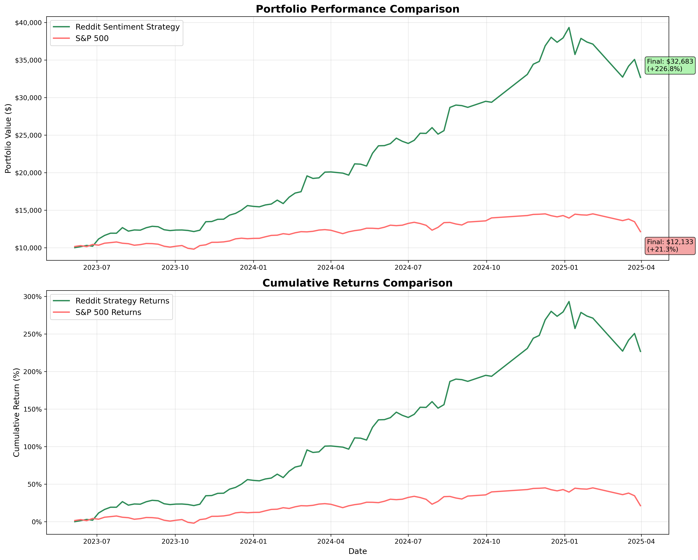

# WSB Sentiment Trader

A backtested trading strategy driven by r/wallstreetbets. It extracts the stock tickers people are
talking about, scores how they feel about them, combines that with short-term price momentum, and
simulates a portfolio.

## Pipeline

`run_complete_pipeline.py` runs the steps in order:

1. **Ticker extraction** (`src/ticker_extraction.py`): regex candidates validated against the
   NASDAQ list, with common English words that look like tickers removed (`remove_common_words.py`).
2. **Sentiment** (`calculate_sentiment.py`): VADER sentiment plus a WSB-specific lexicon
   (`reddit_sentiment_words.json`), aggregated per ticker per week.
3. **Momentum** (`momentum_tracker.py`): 3-day price momentum from Yahoo Finance.
4. **Trading engine** (`trading_engine.py`). Buy when sentiment, momentum and the combined score all
   clear their thresholds and the ticker has 5 or more mentions. Sell at −10% (stop loss), +25% (take profit), or
   when sentiment turns sharply negative. At most 20 positions.
5. **Analysis** (`trading_analysis.py`, `sp500_comparison.py`, `stock_performance_summary.py`):
   charts, win/loss statistics and an S&P 500 benchmark.

`ml_parameter_optimizer.py` / `ml_unbounded_optimizer.py` fit gradient-boosting surrogates over
backtest runs to search the strategy's parameters. `daily_trading_engine.py` runs the same rules on
new data.

## Backtest (June 2023 to April 2025, $10k start)

| | Strategy | S&P 500 |
|---|---|---|
| Total return | +227% | +21% |
| Sharpe | 1.82 | 0.65 |
| Max drawdown | 16.9% | 16.4% |

482 trades, 66.5% of closed trades profitable ([full stats](results/WIN_LOSS_SUMMARY.txt)).

**Read these numbers with suspicion.** The thresholds were tuned on the same period they are
evaluated on. There are no transaction costs or slippage, and the ticker universe is today's NASDAQ
list, which brings survivorship bias. A walk-forward test on unseen months is the honest next step.
This is a research project, not financial advice.

## Data

The Reddit dataset (about 220 MB of r/wallstreetbets posts and comments) is not included. Place it as
`r_wallstreetbets_posts.csv` and run `python run_complete_pipeline.py`. Prices come from `yfinance`.

## Tech

Python · pandas · VADER · yfinance · scikit-learn · matplotlib
